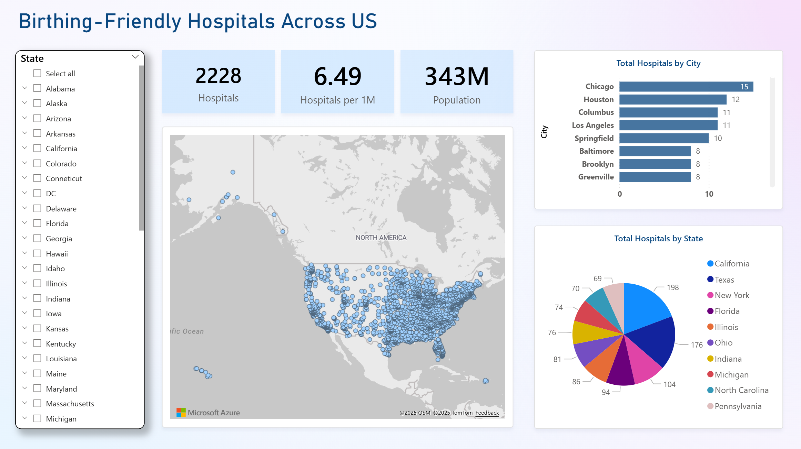

# Birthing-Friendly Hospitals Across US

## Project Overview
This project explores the geographic distribution of birthing-friendly hospitals across the United States. 
It aims to examine where these hospitals are located and how their distribution may relate to access to maternal healthcare. 
By looking at the locations of birthing-friendly facilities, the project provides a geographic perspective on the availability 
of hospital-based resources for people seeking maternity care.

The project focuses on questions such as: Where are birthing-friendly hospitals located across the United States? Are there geographic patterns in their distribution? 
What areas may have fewer identified birthing-friendly hospital options? How can spatial analysis help communicate differences in access to maternal healthcare?

 

## Analytical Insights

**1. Uneven Geographic Distribution**
- The map shows that birthing-friendly hospitals are not evenly distributed across the United States. There is a noticeably higher concentration of hospitals in the eastern half of the country, particularly across the Midwest, Southeast, and Northeast.
- In comparison, the Mountain West and other less densely populated areas appear to have fewer hospital locations.
  
**2. State-Level Concentration**
- California has the highest number of birthing-friendly hospitals displayed, with 198, followed by Texas with 176 and New York with 104.
- Florida (94) and Illinois (86) also rank among the states with the highest counts. This highlights how hospital distribution varies across states.
  
**3. Major Cities Have Higher Hospital Counts**
- Chicago leads the city-level breakdown with 15 hospitals, followed by Houston with 12. Columbus and Los Angeles each have 11, while Springfield has 10.
- These results suggest that larger metropolitan areas and regional population centers account for a substantial share of the hospitals represented in the dashboard.
  
**4. Hospital Availability in Relation to Population**
- The dashboard reports 2,228 hospitals, a population of approximately 343 million, and an average of 6.49 hospitals per million people.
- Including the population-based metric provides another perspective beyond total hospital counts, since states and cities with larger populations may naturally have more hospitals.

## Conclusion

This project uses a geographic perspective to explore the distribution of birthing-friendly hospitals across the United States.
Mapping these facilities can help make regional patterns in maternal healthcare availability easier to understand and can support further discussion about access to
maternity services. The final conclusions should reflect the locations and patterns identified in the completed spatial analysis.
