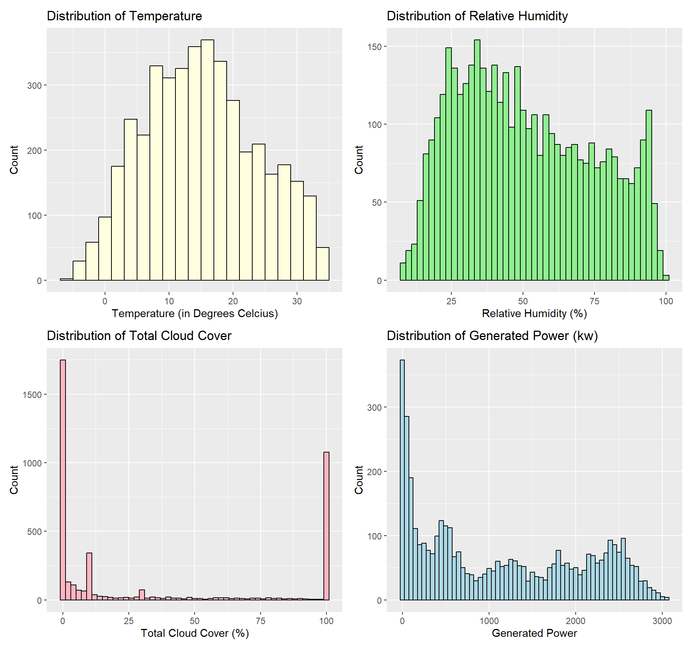
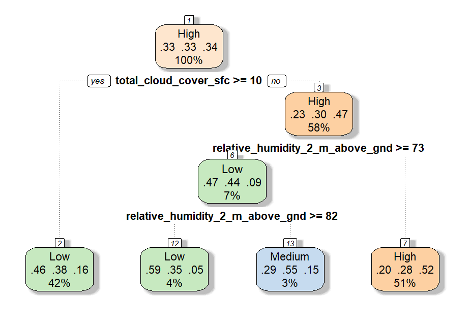

# Effects of Weather on Solar Energy Production

## Objectives of the Project
This project examines how weather conditions influence solar energy production using statistical modeling and machine learning. 
Using the Solar Energy Power Generation dataset from Kaggle, which contains 569 observations and 21 variables, the analysis focuses on weather-related 
factors such as temperature, relative humidity, precipitation, snowfall, cloud cover, and wind conditions.

The project focuses on questions such as: Which weather variables have the strongest relationship with solar power output? Do interactions or nonlinear 
relationships improve predictions? How accurately can models predict continuous solar generation and classify output into Low, Medium, and High levels? 
Which modeling approach provides the most useful results?

 

## Analytical Insights

**1. Temperature, humidity, and cloud cover were the most important weather predictors in the regression analysis**
- The final first-order regression model retained temperature, relative humidity, and total cloud cover.
- The refined interaction and second-order models explained approximately 18–19% of the variation in generated solar power.
- Humidity and cloud cover showed negative relationships with solar output in the selected regression analysis.
  
**2. More complex regression models modestly improved explanatory power**
- Adding interaction and squared terms helped account for relationships that a basic linear model could not capture.
- Forward stepwise feature selection retained humidity, cloud cover, temperature, squared terms for humidity and cloud cover, and the humidity–cloud cover interaction.
- Ridge and LASSO regression produced comparable predictive performance, with an RMSE of approximately 844 kW.
  
**3. K-Nearest Neighbors performed better than the decision tree for classifying solar output**
- Solar generation was grouped into Low, Medium, and High categories using the 33rd and 66th quantiles.
- The decision tree achieved 47.7% accuracy.
- K-Nearest Neighbors, using k = 9, achieved 57.9% accuracy and a Kappa of 0.367, with more balanced performance across output categories.
  
**4. Cloud cover and humidity were important indicators of lower solar generation**
- The decision tree identified cloud cover as its most important predictor.
- Higher cloud cover was associated with a greater likelihood of Low output, while humidity provided an additional split in the tree.
- Overall, the results show that weather conditions can influence solar production through both individual and combined effects.

## Conclusion

The analysis demonstrates that weather conditions play an important role in solar energy production. Temperature, relative humidity, and cloud cover emerged as key predictors, while interaction and nonlinear terms modestly improved the regression models. For classifying solar output into Low, Medium, and High levels, K-Nearest Neighbors outperformed the decision tree, achieving 57.9% accuracy.

These findings show how statistical modeling and machine learning can be used together to better understand solar energy generation. The results may help inform decisions about solar system planning and highlight the importance of considering local weather conditions when evaluating solar energy potential.
