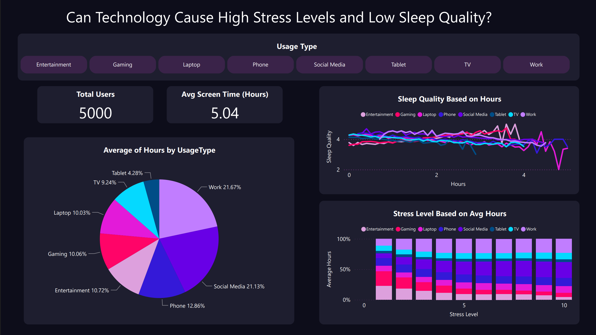
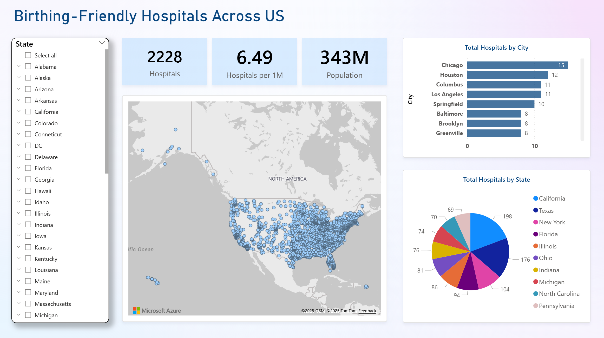
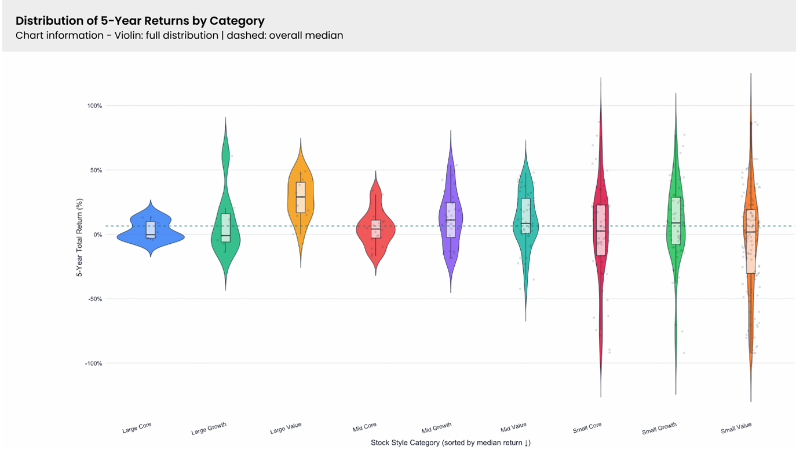
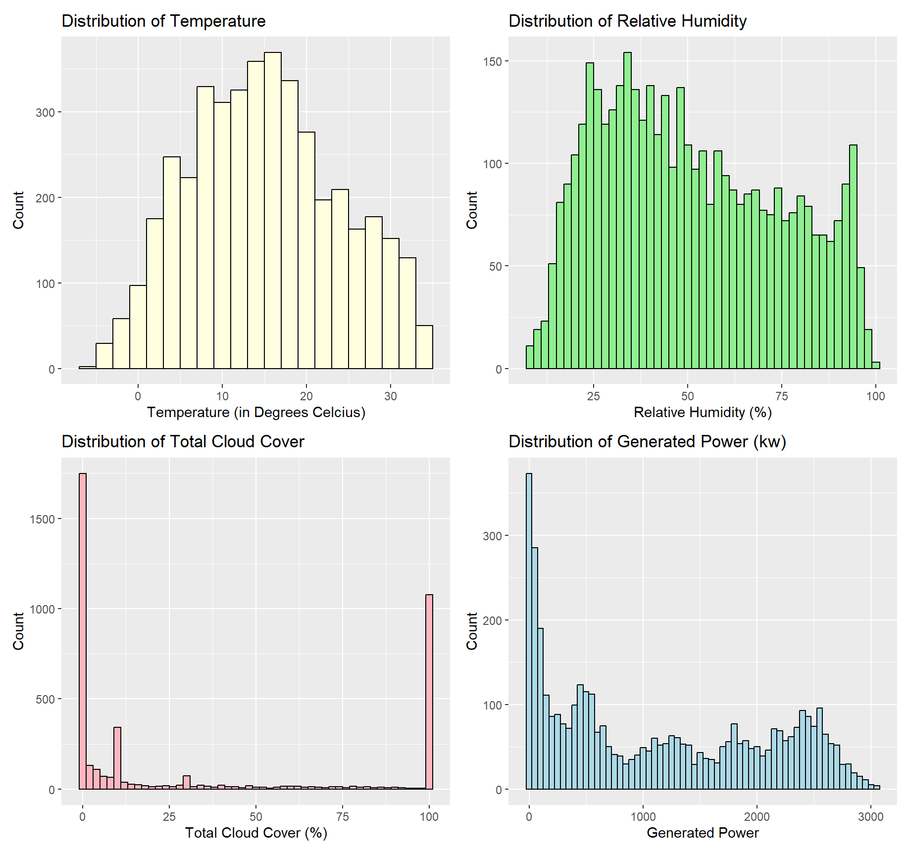
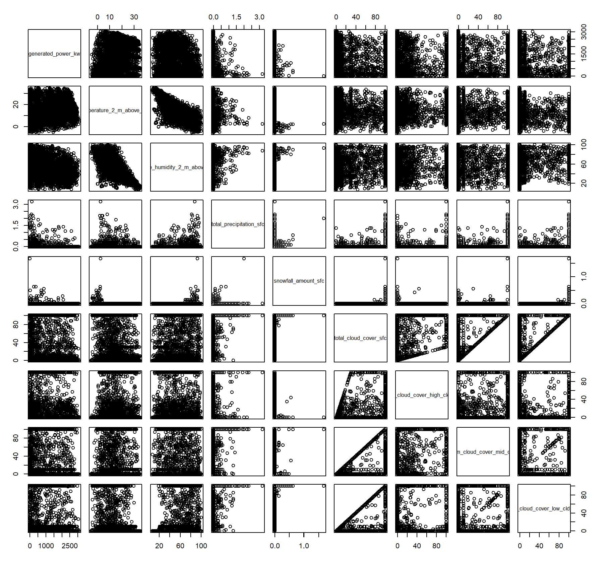
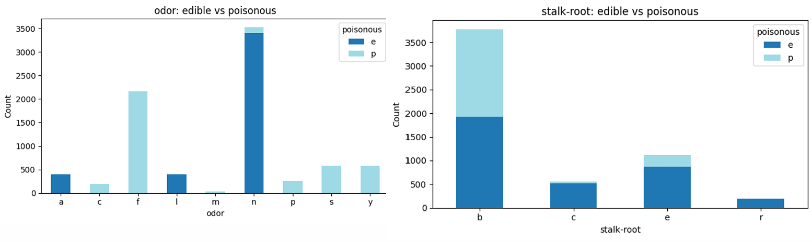
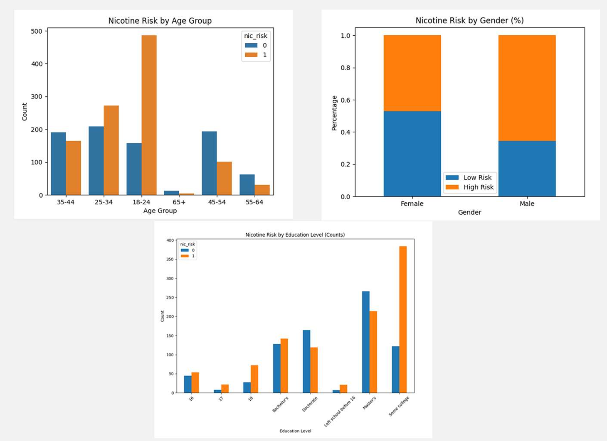

# Data Projects
 

## 
## Technology Use and Its Impact on Wellness
With 5,000 participants, the dataset provides a rich opportunity to study patterns and relationships between technology use and wellness outcomes. Researchers and data scientists can use it to ask questions like: Does heavy screen time impact sleep and stress levels? Is social media linked to mood or anxiety? Can healthy habits offset the negative effects of technology use?

## 
## Birthing-Friendly Hospitals Across US
An analysis of birthing-friendly hospitals across the United States, exploring their geographic distribution and accessibility to maternal healthcare services. This project uses data visualization and spatial analysis to identify patterns in hospital locations and highlight potential gaps in access to quality maternal care.

## 
## Beyong Market Size
### How Company Scale and Style Influence Financial Returns and Growth
 
## 

## Effects of Weather on Solar Energy Production
An analysis of how weather conditions influence solar energy production using statistical modeling and machine learning. By examining factors such as temperature, relative humidity, and cloud cover, this project evaluates their effects on solar output and compares regression and classification models to better understand and predict energy generation.

  

| | |
|---|---|
|  |  |

## 

## Machine Learning on Poisonous Vs Nonpoisonous Mushrooms

 

Machine learning classification project predicting whether mushrooms are **poisonous or edible** using physical characteristics from the UCI Mushroom Dataset.

I compared multiple classification algorithms—including **Decision Trees, Random Forest, Gradient Boosting, Support Vector Classification, and Logistic Regression**—and evaluated their performance using accuracy and recall. Because incorrectly classifying a poisonous mushroom as edible represents a high-cost false negative, recall was treated as a key evaluation metric.

The project includes **data preprocessing, one-hot encoding, train/test splitting, 5-fold cross-validation, hyperparameter tuning, model complexity analysis, and feature importance analysis**. Several models achieved 100% accuracy and recall, with **odor-related characteristics consistently emerging as important predictors**.

**Skills:** Python · Pandas · Scikit-learn · Exploratory Data Analysis · Data Preprocessing · Classification · Hyperparameter Tuning · Cross-Validation · Model Evaluation · Feature Importance

## 

## Using Machine Learning to Predict Nicotine Dependence Based on Psychological and Demographic Factors
This project explores the use of machine learning to identify patterns associated with nicotine dependence risk based on demographic, psychological, and behavioral factors. Using the Drug Consumption (Quantified) dataset containing 1,885 participants, the analysis examines how characteristics such as age, education, personality traits, impulsivity, and sensation-seeking relate to nicotine risk.

The project focuses on questions such as: Which demographic and psychological factors are associated with higher nicotine risk? How accurately can machine learning classify nicotine risk? Which classification model performs best? Which characteristics are the strongest predictors of nicotine dependence risk?
 
